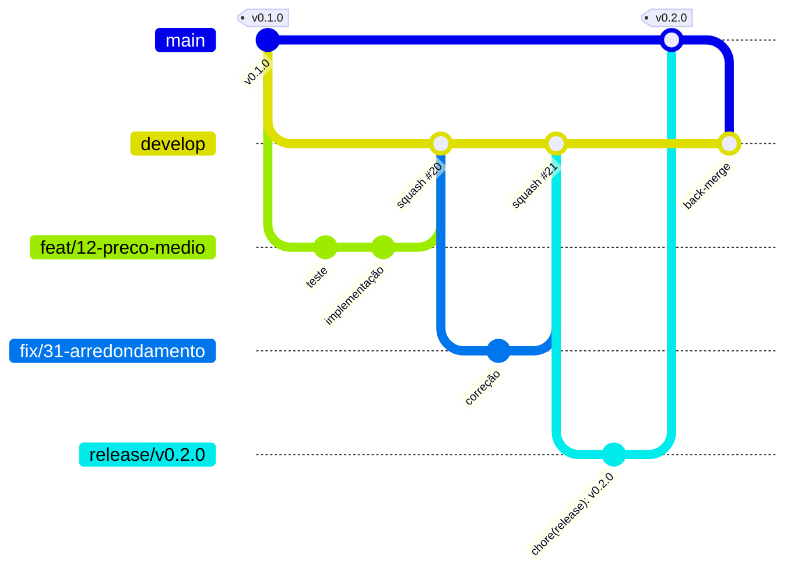

# Como contribuir

O projeto usa **Gitflow simplificado** com dois ambientes ([ADR-008](docs/adr/0008-gitflow-com-staging-e-releases.md)):

| Branch | Ambiente | Recebe código de |
| --- | --- | --- |
| `develop` | 🧪 staging | branches de trabalho (`feat/`, `fix/`…) |
| `main` | 🚀 produção | `release/vX.Y.Z` e `hotfix/*` |



## 1. Trabalhar numa issue

```bash
git switch develop && git pull
git switch -c feat/12-preco-medio        # tipo/número-da-issue-descrição
```

Prefixos aceitos: `feat/`, `fix/`, `refactor/`, `perf/`, `test/`, `docs/`, `chore/`, `ci/`.
O prefixo define o rótulo de tipo do PR automaticamente.

## 2. Commits

[Conventional Commits](https://www.conventionalcommits.org/pt-br/), verificados no seu computador
(hook do husky) e na CI:

```
feat(trading): executar ordem a mercado ao último preço
fix(portfolio): corrigir arredondamento do preço médio
docs(adr): ADR-009 cache de cotações
```

| Tipo | Quando |
| --- | --- |
| `feat` | Nova funcionalidade |
| `fix` | Correção de bug |
| `refactor` | Melhoria interna sem mudar comportamento |
| `perf` | Desempenho |
| `test` | Só testes |
| `docs` | Documentação e ADRs |
| `style` | Formatação |
| `build` / `ci` | Build, dependências, pipelines |
| `chore` | Manutenção |
| `revert` | Desfazer um commit |

Escopos: `backend`, `frontend`, `bridge`, `infra`, um módulo (`identity`, `marketdata`, `trading`,
`portfolio`, `corporateactions`, `analytics`, `shared`, `simulator`) ou `docs`, `adr`, `ci`, `deps`,
`release`. Mudança que quebra compatibilidade: `feat(trading)!: …` e rodapé `BREAKING CHANGE: …`.

Para ativar o hook e o modelo de mensagem uma vez por clone:

```bash
npm install                                   # instala o husky na raiz
git config commit.template .gitmessage
```

## 3. Pull request para a `develop`

- **Título** em Conventional Commits: ele vira o commit do squash e entra no CHANGELOG
- Preencha o template (resumo, issue, como testar, evidências)
- Rótulos de área, módulo, tipo e tamanho são aplicados sozinhos; você vira o responsável
- A CI precisa estar verde: testes, arquitetura, lint, título, commits e política de branches
- Merge com **Squash and merge**. Ao entrar na `develop`, o deploy de **staging** dispara

## 4. Release para produção

1. Em **Actions → Release → Run workflow**, escolha `patch`, `minor` ou `major`
2. O workflow cria `release/vX.Y.Z`, atualiza as versões e o `CHANGELOG.md` e abre o PR para a `main`
3. Valide em staging, revise o PR e faça o merge com **Create a merge commit**
4. Automaticamente: tag `vX.Y.Z`, GitHub Release com notas por rótulo, deploy de **produção** e PR
   de back-merge `main → develop` (merge commit também)

## 5. Hotfix

```bash
git switch main && git pull
git switch -c hotfix/corrige-calculo-caixa
```

PR para a `main` usando o template de hotfix (`?template=hotfix.md` na URL do PR). No merge, a
versão de patch é publicada e o back-merge para a `develop` é aberto sozinho.

## Verificações locais

```bash
cd backend && ./mvnw verify                       # testes, arquitetura, formatação, cobertura
cd frontend && npm run lint && npm test -- --watch=false && npm run build
cd mt5-bridge && ruff check . && ruff format --check . && mypy . && pytest
```

## Definition of Done

- Testes novos cobrindo o comportamento, todos verdes na CI
- Quality gate aprovado, sem novo code smell crítico
- Nomes seguem o glossário; nenhuma regra de negócio fora do `domain`
- API documentada no OpenAPI e cliente Angular regenerado, se mudou
- Migration Flyway incluída, se mudou o banco
- ADR escrito, se houve decisão de arquitetura
- README ou docs atualizados, se mudou algo que quem chega precisa saber
