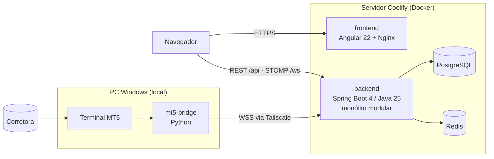

# Simulador de Carteira de Investimentos

[](https://github.com/diogosilvasantana/simulador-carteira-investimentos/actions/workflows/backend.yml)
[](https://github.com/diogosilvasantana/simulador-carteira-investimentos/actions/workflows/frontend.yml)
[](https://github.com/diogosilvasantana/simulador-carteira-investimentos/actions/workflows/mt5-bridge.yml)

Home broker **simulado** com cotações reais da B3. Serve como ambiente de prática para montar e
gerir carteiras (renda passiva, valorização, mista) antes de investir dinheiro de verdade.
Nenhuma ordem chega ao mercado: compras, vendas, custos e proventos são simulados com as mesmas
regras de uma corretora.

## O que o projeto faz

- Carteiras fictícias com perfil, capital inicial e alocação-alvo
- Ordens de compra e venda executadas ao preço de mercado em tempo real
- Posição com preço médio, resultado realizado e não realizado ao vivo
- Proventos (dividendos, JCP), rentabilidade contra Ibovespa e CDI, sugestão de rebalanceamento
- Simulador de pregão (replay, sintético e cenários) para praticar com a bolsa fechada

## Arquitetura em uma imagem



Documentação completa em [`docs/architecture`](docs/architecture/README.md) e decisões em
[`docs/adr`](docs/adr/README.md).

## Estrutura do monorepo

| Pasta | Conteúdo | Stack |
| --- | --- | --- |
| [`backend/`](backend/) | API, regras de negócio, tempo real | Java 25, Spring Boot 4, Spring Modulith |
| [`frontend/`](frontend/) | Home broker e painéis | Angular 22 (zoneless, signals) |
| [`mt5-bridge/`](mt5-bridge/) | Ponte entre o MetaTrader 5 e o backend | Python 3.12+ |
| [`infra/`](infra/) | Docker Compose, configuração do Coolify | Docker |
| [`docs/`](docs/) | Arquitetura, ADRs, backlog | Markdown + Mermaid |

## Como rodar localmente

Pré-requisitos: JDK 25, Node 22+, Docker. O Maven vem pelo wrapper (`./mvnw`).

No Windows, com o MetaTrader 5 aberto, um comando sobe backend, frontend e ponte, cada um na sua
janela, e abre o navegador ([guia completo](docs/guias/rodar-local-windows.md)):

```powershell
.\dev.cmd                     # cotações reais do MT5
.\dev.cmd -Source synthetic   # mercado fechado
.\dev.cmd -Stop               # encerra tudo
```

Cada parte separada:

```bash
# backend sem banco (perfil local; o padrão exige PostgreSQL via SPRING_DATASOURCE_URL)
cd backend && ./mvnw spring-boot:run -Dspring-boot.run.profiles=local

# frontend
cd frontend && npm ci && npm start

# tudo em containers
docker compose -f infra/compose.yaml up --build
```

## Fluxo de desenvolvimento

Gitflow simplificado com dois ambientes ([ADR-008](docs/adr/0008-gitflow-com-staging-e-releases.md)):

| Branch | Ambiente | Como o código chega |
| --- | --- | --- |
| `develop` | 🧪 staging | PRs de `feat/`, `fix/`, `docs/`… (squash) |
| `main` | 🚀 produção | PR de `release/vX.Y.Z` gerado pelo workflow Release, ou `hotfix/*` |

Commits e títulos de PR em Conventional Commits, rótulos automáticos por área, módulo, tipo e
tamanho, CHANGELOG e notas de versão gerados a cada release. Detalhes no
[`CONTRIBUTING.md`](CONTRIBUTING.md).

## Aviso sobre dados de mercado

As cotações vêm da conta pessoal do usuário na corretora e da série histórica pública da B3, e são
usadas apenas para fins de estudo. Este projeto não redistribui dados de mercado e não é
recomendação de investimento.

## Licença

[MIT](LICENSE)
