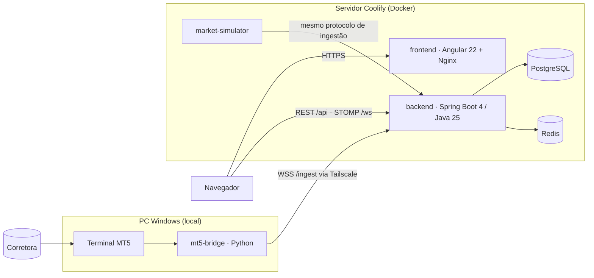

# Arquitetura

Versão no repositório do documento de arquitetura. Decisões detalhadas ficam em
[`docs/adr`](../adr/README.md).

## 1. Visão e objetivos

Home broker fictício com cotações reais da B3 para praticar a montagem e a gestão de carteiras.
Nenhuma ordem chega ao mercado.

- **Produto:** carteiras com perfil (renda passiva, valorização, mista), ordens a mercado em
  tempo real, posição com preço médio, proventos, rentabilidade contra Ibovespa e CDI,
  rebalanceamento
- **Engenharia:** monólito modular com fronteiras verificadas, testes automatizados, CI no
  GitHub, deploy reproduzível no Coolify

## 2. Direcionadores arquiteturais

Prioridade quando houver conflito: **correção financeira > frescor da cotação > simplicidade de
operação**.

### Cenários de qualidade

| ID | Atributo | Cenário | Resposta esperada |
| --- | --- | --- | --- |
| QA1 | Correção | Compra de 100 PETR4 em 3 execuções com preços e custos diferentes | Preço médio e caixa batem com o cálculo manual até o centavo |
| QA2 | Correção | A mesma ordem chega duas vezes | Uma única execução (chave de idempotência) |
| QA3 | Frescor | Tick com 30 ativos assinados | Preço na tela em até 1 s no p95 |
| QA4 | Disponibilidade | PC ou MT5 cai no pregão | Em até 15 s, feed `STALE` na tela e ordens a mercado recusadas |
| QA5 | Recuperação | Ponte volta após 2 min fora | Reconecta sozinha; feed volta a `LIVE` no primeiro tick |
| QA6 | Auditabilidade | "Por que o caixa está em R$ 9.512,30?" | Histórico de execuções e proventos reconstrói o valor |
| QA7 | Segurança | Usuário A pede a carteira de B | 404, coberto por teste |
| QA8 | Testabilidade | Testes sem MT5 e sem internet | Passam com replay e Testcontainers em menos de 5 min |
| QA9 | Implantação | Merge na `main` | No ar em menos de 10 min, sem passo manual |

### Restrições

- MT5 e o pacote Python oficial só rodam em Windows
- Um servidor Coolify (2 vCPU, 8 GB) dividido com outros projetos; orçamento perto de zero
- Dados de mercado da conta pessoal: sem redistribuição
- Backend em Java e frontend em Angular (objetivo de aprendizado); um desenvolvedor

### Premissas

- O PC local é Windows e fica ligado durante o pregão (senão, VPS Windows — ADR-003)
- A corretora libera no MT5 os ativos desejados
- Poucas dezenas de ativos assinados e menos de 10 usuários simultâneos
- Execução simulada ao último preço basta no MVP

## 3. Containers

## 4. Stack

| Camada | Escolha |
| --- | --- |
| Backend | Java 25 LTS, Spring Boot 4.1, Spring Modulith 2.1 |
| Persistência | PostgreSQL 17, Spring Data JPA, Flyway |
| Cache e pub/sub | Redis |
| Tempo real | WebSocket + STOMP |
| Segurança | Spring Security + JWT |
| API | REST + OpenAPI (springdoc), cliente TypeScript gerado |
| Frontend | Angular 22 (standalone, zoneless, signals), Lightweight Charts |
| Ponte | Python 3.12+ com o pacote `MetaTrader5` |
| Rede privada | Tailscale |
| Qualidade | JUnit 5, ArchUnit, Testcontainers, JaCoCo, Spotless, SonarQube Cloud |
| Deploy | Docker + Coolify, GitHub Actions, GHCR |

## 5. Backend: módulos

| Módulo | Responsabilidade | Publica | Consome |
| --- | --- | --- | --- |
| `identity` | Usuários, login, JWT | `UserRegistered` | — |
| `marketdata` | Ingestão de ticks, última cotação, candles, replay, catálogo de ativos | `QuoteUpdated`, `FeedStatusChanged` | — |
| `trading` | Ordens, validação, execução simulada, custos | `OrderExecuted`, `OrderRejected` | `QuoteUpdated` |
| `portfolio` | Carteiras, caixa, posições, preço médio, alocação-alvo | `PositionChanged`, `CashMoved` | `OrderExecuted`, `DividendPaid` |
| `corporateactions` | Proventos, desdobramentos, grupamentos | `DividendPaid`, `SplitApplied` | `PositionChanged` |
| `fixedincome` | Indexadores (CDI, Selic, IPCA), renda fixa simulada, IR e IOF ([ADR-011](../adr/0011-renda-fixa-simulada-com-indexadores-oficiais.md)) | `IndexRatesUpdated` | — |
| `analytics` | Rentabilidade (TWR), benchmarks, rebalanceamento | — | `PositionChanged`, `CashMoved`, `QuoteUpdated` |
| `shared` | Tipos comuns (`Money`, `Ticker`) | — | — |

Dentro de cada módulo: `domain` (Java puro) · `application` (casos de uso, portas) ·
`adapters/in` · `adapters/out`.

## 6. Modelo de domínio

```mermaid
flowchart LR
    C1[Enviar ordem] --> A1[Order] --> E1[OrderExecuted]
    E1 -. toda execução atualiza a carteira .-> C2[Aplicar execução]
    C2 --> A2[Portfolio] --> E2[PositionChanged]
    E2 -. posição na data com dá direito .-> C3[Registrar direito]
    C3 --> A3[CorporateAction] --> E3[DividendPaid]
    E3 -. no pagamento, creditar caixa .-> C4[Creditar provento]
    C4 --> A4[Portfolio] --> E4[CashMoved]
```

Regras de cálculo:

1. Compra: novo PM = (qtd atual × PM atual + valor comprado + custos) ÷ nova qtd
2. Venda: PM não muda; resultado realizado = (preço de venda − PM) × qtd − custos
3. Resultado não realizado = (última cotação − PM) × qtd, a cada tick
4. Provento: direito de quem tem posição no fim da data com; crédito na data de pagamento,
   líquido de IR quando houver
5. Desdobramento e grupamento ajustam quantidade e PM sem mudar o custo total
6. Venda acima da posição é recusada (sem venda a descoberto no MVP)

Custos e impostos ficam em tabela configurável versionada por data, conferida nas fontes
oficiais antes das fases 3 e 6.

Ciclo da ordem: `NEW → ACCEPTED → FILLED`, com saídas `REJECTED`, `CANCELED` e `EXPIRED`.

## 7. Dados de mercado

1. MT5 no PC → `mt5-bridge` lê ticks a cada 250 ms
2. Conexão de saída WSS até `/ingest` (Tailscale + token), heartbeat a cada 5 s
3. `marketdata` valida, grava a última cotação no Redis, publica `QuoteUpdated`
4. Candles de 1 minuto no Postgres
5. Fan-out STOMP em lotes de 500 ms: `/topic/quotes/category/{categoria}` para listas,
   `/topic/quotes/{ticker}` para um ativo e `/topic/portfolios/{id}`
6. Sem heartbeat por 15 s: `FeedStatusChanged(STALE)`, ordens a mercado recusadas

### Simulador de pregão

O serviço `market-simulator` fala o mesmo protocolo da ponte, para rodar o sistema inteiro com a
bolsa fechada:

| Modo | Preços |
| --- | --- |
| Replay | Candles gravados, a 1×, 10× ou 60× |
| Sintético | Movimento browniano geométrico calibrado pela volatilidade histórica de cada ativo |
| Cenários | Queda de 10% em 5 min, gap de abertura, alta volatilidade, feed que cai e volta |

Relógio injetável (`java.time.Clock`), semente fixa para testes determinísticos, e cada carteira
guarda a fonte de dados (`LIVE`, `REPLAY`, `SYNTHETIC`) com selo SIMULADO na tela.

### Universo de ativos

O catálogo nasce do MT5 ([ADR-010](../adr/0010-catalogo-de-ativos-pela-especificacao-b3.md)): a
ponte envia ticker e descrição, e o domínio lê a especificação B3 da descrição para definir o
tipo de ativo (`AssetType`), a categoria da vitrine (`AssetCategory`: ações, FIIs, Fiagros, ETFs e
BDRs) e o segmento de listagem (`ListingSegment`: Novo Mercado, N1, N2, Bovespa Mais). Setor e
segmento de FII virão do Cadastro de Instrumentos e da Classificação Setorial da B3 e do Informe
Mensal de FII da CVM.

Histórico diário para replay e volatilidade vem da
[série histórica oficial da B3 (COTAHIST)](https://www.b3.com.br/pt_br/market-data-e-indices/servicos-de-dados/market-data/historico/mercado-a-vista/cotacoes-historicas/),
sem ajuste por proventos: `corporateactions` ajusta desdobramentos antes de calcular
volatilidade. Uso informativo, sem redistribuição.

## 8. Frontend

`core/` (auth, STOMP, erros) · `shared/` (componentes visuais) · `features/portfolios` ·
`features/trading` · `features/market` · `features/analytics` · `api/` (gerado do OpenAPI).
Cotações em signals, valores derivados em `computed`.

## 9. Deploy e operação

| Serviço | Exposto |
| --- | --- |
| `frontend` (Nginx) | Domínio público, HTTPS |
| `backend` | `/api` e `/ws` pelo domínio; `/ingest` só na Tailscale |
| `postgres`, `redis` | Rede interna |

Gitflow (ADR-008): `develop` publica em staging e `main` em produção, pelo workflow `Deploy` que
chama a API do Coolify. CI por caminho em todo PR (build, testes, ArchUnit, lint, título, commits
e política de branches); o workflow `Release` corta versões com CHANGELOG e tag.

## 10. Roadmap

| Fase | Entrega | Pronto quando |
| --- | --- | --- |
| 1 · Núcleo | Carteiras, ordens a mercado, posição, preço médio | PM e custos corretos em teste |
| 2 · Tempo real | Ponte MT5, WebSocket, replay, home broker | Tick na tela em até 1 s |
| 3 · Proventos | Dividendos, JCP, data com, desdobramentos | Confere com extrato |
| 4 · Rentabilidade | TWR, Ibovespa, CDI | Série confere à mão |
| 5 · Rebalanceamento | Alocação-alvo, sugestão de aporte | Desvio por ativo na tela |
| 6 · Extras | Ordens stop, IR mensal, book simulado | Apuração mensal fecha |
