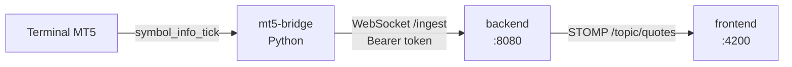

# Rodar tudo no Windows com o MT5

Guia para ver cotações reais do MetaTrader 5 na tela do simulador, tudo no mesmo PC.



A ponte só lê cotações. Ela nunca envia ordens ao MT5.

## Tudo de uma vez

Com os pré-requisitos instalados (seção 1), na raiz do projeto:

```powershell
.\dev.cmd                          # MT5 aberto e logado, todos os ativos
.\dev.cmd -Source synthetic        # mercado fechado
.\dev.cmd -Symbols PETR4,VALE3     # só alguns ativos
.\dev.cmd -Stop                    # encerra tudo
```

O comando confere Java e Node, escolhe uma porta livre para o backend (se a 8080 estiver com o
Apache, usa a 8081), espera o backend subir, liga o frontend apontando para essa porta, prepara o
ambiente Python da ponte e abre <http://localhost:4200/cotacoes>. Cada parte fica na sua janela,
para ver os logs. As seções abaixo mostram o passo a passo manual.

## 1. Pré-requisitos (uma vez só)

No PowerShell:

```powershell
winget install EclipseAdoptium.Temurin.25.JDK
winget install OpenJS.NodeJS.LTS
winget install Python.Python.3.13
winget install Git.Git
```

Feche e abra o terminal e confira: `java -version` (25), `node -v` (22 ou mais), `py -3.13 --version`.

O MT5 precisa estar **aberto e logado** na conta da corretora (demo serve), com os ativos da B3
disponíveis na Observação do Mercado.

```powershell
git clone https://github.com/diogosilvasantana/simulador-carteira-investimentos.git
cd simulador-carteira-investimentos
git switch feat/tempo-real-mt5   # até o PR #36 entrar na develop
```

## 2. Backend (terminal 1)

```powershell
cd backend
.\mvnw.cmd spring-boot:run "-Dspring-boot.run.profiles=local"
```

O perfil `local` aceita o token `local-dev-token`. Quando aparecer `Started SimuladorCarteiraApplication`,
<http://localhost:8080/api/quotes> deve responder `[]`.

## 3. Frontend (terminal 2)

```powershell
cd frontend
npm ci
npm start
```

Abra <http://localhost:4200/cotacoes>. O selo deve mostrar **Ao vivo** e a tabela, a mensagem de vazia.

## 4. Ponte (terminal 3)

```powershell
cd mt5-bridge
py -3.13 -m venv .venv
.venv\Scripts\python -m pip install -e ".[mt5]"
$env:BRIDGE_INGEST_TOKEN = "local-dev-token"
.venv\Scripts\python -m mt5_bridge --source mt5 --symbols PETR4,VALE3,ITUB4,BBAS3,MXRF11,BOVA11
```

Com a bolsa aberta os preços começam a piscar em verde e vermelho na tela. A coluna Fonte mostra **MT5**.

### Todos os ativos

Troque a lista por `all` para acompanhar todo o mercado à vista da corretora: ações, units, FIIs,
Fiagros, ETFs e BDRs (ficam de fora opções, futuros e fracionário):

```powershell
.venv\Scripts\python -m mt5_bridge --source mt5 --symbols all
```

A ponte manda o cadastro de cada ativo ao conectar e lê o mercado a cada 1 s (`--interval-ms`
muda isso). Em <http://localhost:4200/cotacoes> cada categoria tem a sua aba, e a tela só carrega e
atualiza a aba aberta. A variação em % é calculada sobre o fechamento do pregão anterior, lido do
candle diário: nos primeiros segundos ela aparece aos poucos, 50 ativos por leitura.

### Horário errado na tela

O MT5 informa os horários no relógio do servidor da corretora. A ponte detecta o fuso comparando o
tick mais recente com o relógio do PC, o que só funciona com o mercado aberto. Se a coluna Horário
ficar adiantada ou atrasada, informe o fuso: `--server-utc-offset -3`.

### Mercado fechado

Troque a fonte para a sintética, que não precisa do MT5:

```powershell
.venv\Scripts\python -m mt5_bridge --source synthetic --symbols PETR4,VALE3,MXRF11 --seed 7
```

A mesma semente sempre gera a mesma sequência de preços.

## Problemas comuns

| Sintoma | Causa provável |
| --- | --- |
| `ativo indisponível na corretora, ignorado` | A corretora usa outro nome (ex.: `PETR4.SA`) ou o ativo não está liberado. Rode o spike (`spikes/mt5_spike.py`) para ver os nomes |
| `Falha ao conectar no MT5` | Terminal fechado, não logado ou instalado em outra pasta |
| `Conexão perdida (HTTP 401)` | Token da ponte diferente do backend; confira `BRIDGE_INGEST_TOKEN` |
| `Conexão perdida` repetindo | Backend ainda subindo ou parado; a ponte reconecta sozinha |
| Selo **Conectando…** no navegador | Backend parado ou o `npm start` sem o proxy |
| Porta 8080 ocupada (Apache, XAMPP, outro projeto) | Use o `dev.cmd`, que escolhe outra porta sozinho. No manual: `"-Dspring-boot.run.arguments=--server.port=8081"` no backend, `$env:BACKEND_PORT = '8081'` antes do `npm start` e `--url ws://localhost:8081/ingest` na ponte |
| Preços parados com a bolsa aberta | Pré-abertura ou leilão; a ponte usa a melhor oferta de compra até sair negócio |
